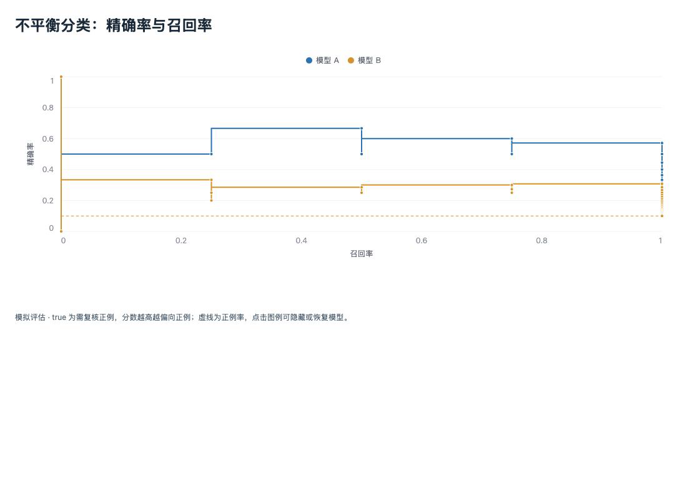

# 不平衡分类的精确率与召回率

在同一批不平衡样本上比较两个模型的阈值权衡与 AP。



## 任务与输入

完整任务见 [prompt.md](prompt.md)，输入为 [scores.json](inputs/scores.json)，字段、单位和模拟来源见 [context.md](inputs/context.md)。本例为原创模拟测试材料，按本仓库 MIT 许可提供，不代表真实业务、实验或模型评估结果。

同一模拟留出集有 40 个样本、4 个正例；true 表示需复核的正例。A/B 分数越高越偏向正例，但不是已校准概率。相同分数按同一阈值计算，AP 使用召回增量加权精确率，不以梯形积分或 ROC AUC 替代。

## 结果与打开方式

- [交互 HTML](result/visualization.html)
- [可重放请求](result/visualization.request.json)
- [使用数据及来源](result/visualization.data.json)

虚线表示每个模型的正例率基线；点击图例可隐藏或恢复对应模型及基线。Tooltip 显示阈值、召回率、精确率、AP 与样本数。

HTML 内嵌使用数据，浏览器打开后不依赖原始 CSV/JSON 文件或仓库服务；需要访问 `unpkg.com` 的 VChart/statplots **2.2.2** 固定版本脚本，结果不是完全离线页面。

浏览器允许本地 HTML 和外部脚本时，可直接打开 `result/visualization.html`。也可以在本例目录启动仅监听本机的静态预览：

```sh
python3 -m http.server 8000 --bind 127.0.0.1 --directory result
```

然后打开 `http://127.0.0.1:8000/visualization.html`。

## 复作与继续改图

安装完整的 `data-science-visualization` Skill，将本例 `prompt.md` 和 `inputs/` 复制到独立工作区交给 Agent，写入新的 `outputs/`。生成时需要 Python 3.11+；本例输入只需要标准库。生成前不要把本例 `result/` 或预览作为参考答案交给 Agent。

已有请求内嵌使用数据，可以独立重放和继续修改。将 `DSV_SKILL_DIR` 设置为实际安装的 Skill 目录，从本例目录执行：

```sh
python3 "$DSV_SKILL_DIR/scripts/generate_visualization.py" \
  --request result/visualization.request.json \
  --output replay
```

输出目录 `replay` 必须尚不存在。浏览器中的临时选择不会自动写回磁盘 request；改图时使用保存的请求，并生成新目录。
